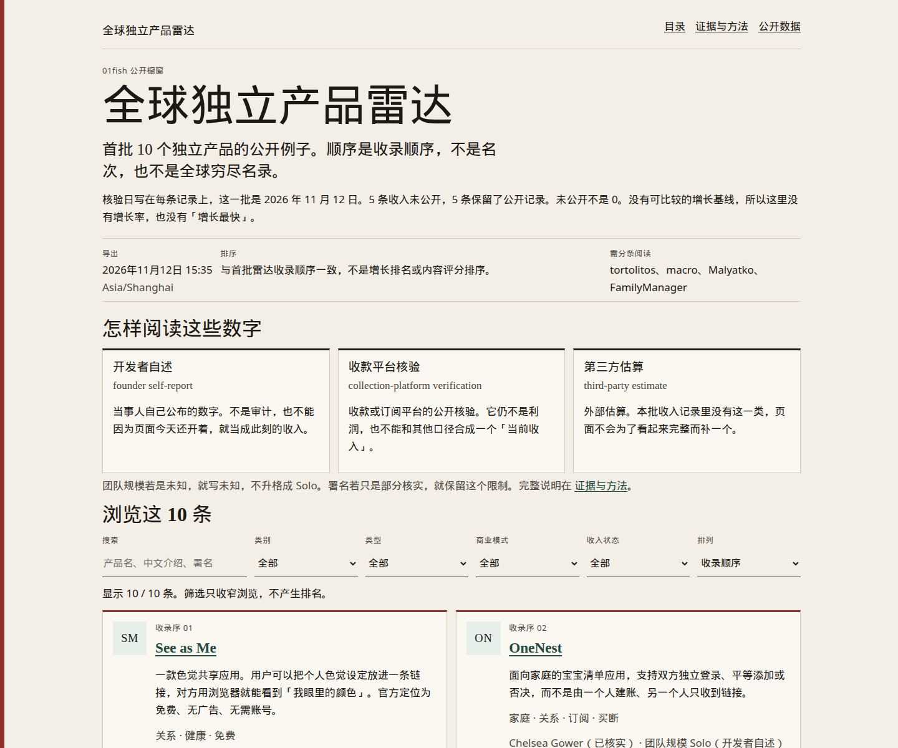
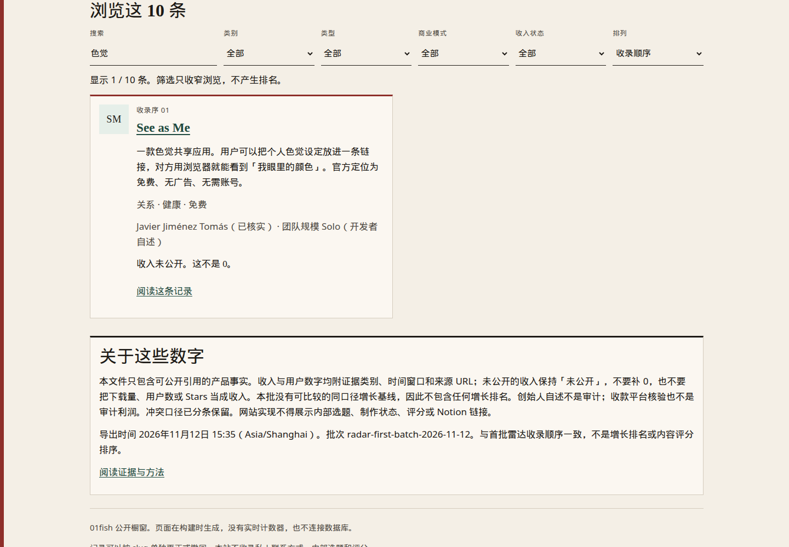
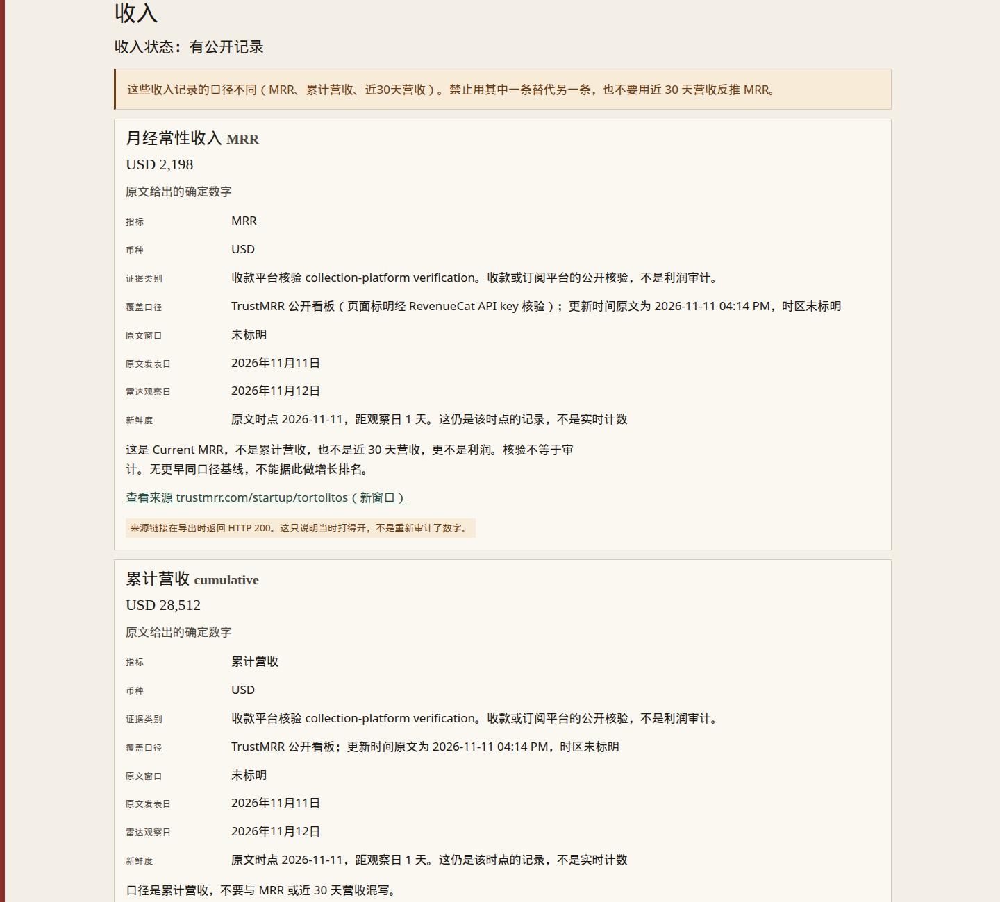
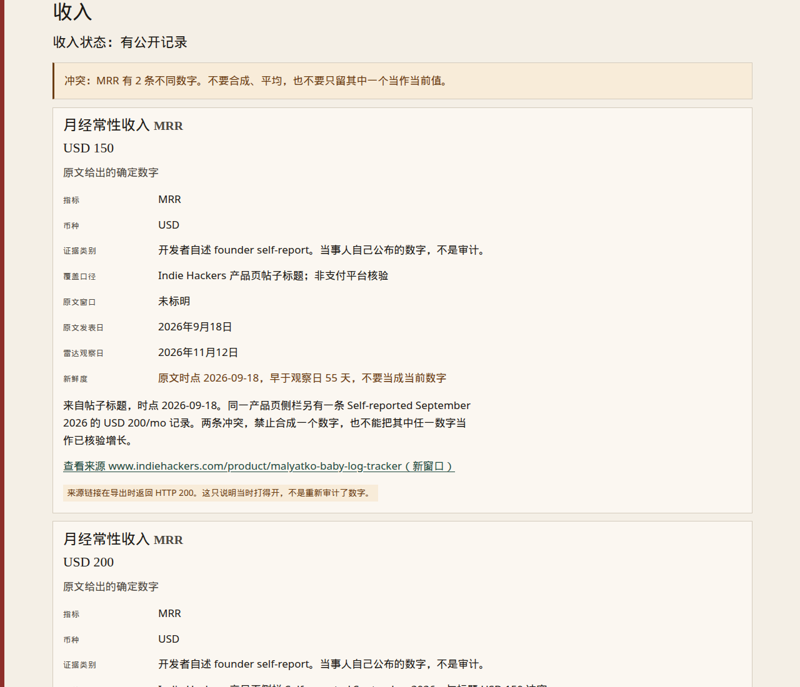
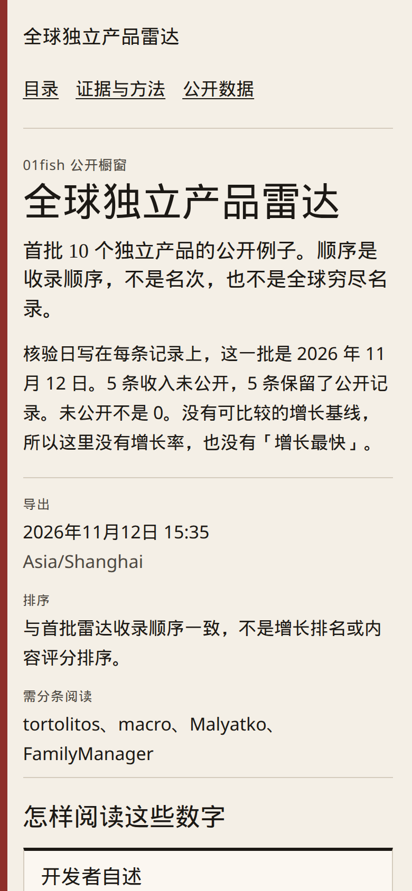
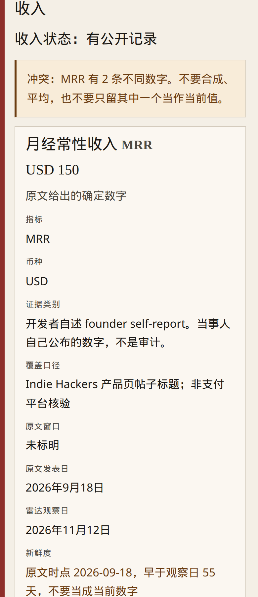

# 全球独立产品雷达

01fish 的公开橱窗。这个仓库用一份公开 JSON 生成静态网页，展示首批 10 个独立产品例子。它不是增长榜，也不是全球产品普查。

页面保留英文产品名，说明以中文为主。收入按原口径分条列出：指标（MRR / 累计营收 cumulative / 近 30 天营收 last 30 days）、币种、原文时点、证据类别和来源。证据类别对应关系是：

- 开发者自述：founder self-report
- 收款平台核验：collection-platform verification
- 第三方估算：third-party estimate（本批收入里没有这一类）

未公开就是未公开，不补 0。团队规模未知时不写成 Solo。署名只核到一部分时保留「部分核实」。冲突数字并列，不合成一个当前收入。没有可比较基线，所以没有增长率。

## 本地运行

需要 Node.js 22 或更新版本。没有需要安装的依赖。

```bash
npm test
npm run build
npm start
```

浏览器打开 `http://127.0.0.1:4173/`。

要按 GitHub Pages 的仓库子路径预览：

```bash
npm run build
BASE_PATH=/global-indie-product-radar PORT=4173 npm start
```

然后打开 `http://127.0.0.1:4173/global-indie-product-radar/`。详情页可以直接打开或刷新，例如 `products/tortolitos/index.html`。站内链接都是相对路径，不依赖网站挂在域名根目录。

`npm start` 只读取已经构建的 `dist/`。改了数据或模板之后需要重新 `npm run build`。

## 测试

```bash
npm test
```

测试覆盖：

- 数据结构和隐私边界：必填字段、证据类别、https 来源、收入未公开时不能夹带数字、禁止 Notion 地址、邮箱、凭据和图片热链
- 本批不能丢掉的事实：Malyatko 的两条 MRR、tortolitos 的三种收入口径、用户数冲突、未知团队规模、部分核实的署名、Devpost 的 HTTP 403
- 搜索、类别、类型、商业模式、收入状态筛选，以及收录顺序和英文名排序
- 构建结果、相对链接、无障碍基础（语言、视口、标题、标签、跳转链接、对比度）和窄屏样式
- 用仓库子路径提供静态文件时，详情页和样式仍能打开

## 公开数据怎么更新

唯一数据源是 `data/products.public.json`。对外页不要自动同步内部草稿。建议人工复核后再替换这份文件。

更新时：

1. 只写入已经可以公开引用的事实。不要加入内部选题、制作状态、评分、Notion 链接或数据库 ID、邮箱、电话、住址、凭据。
2. 不要热链或下载官网截图、标志和宣传图。页面用文字和字标。
3. 同一指标的新快照追加为新记录，保留旧的时间窗口。不要覆盖旧数字后说成一直如此。
4. 收入记录要保留指标、币种、数值限定、证据类别、覆盖口径、原文窗口、来源 URL 和备注。用户数不要放进收入。
5. 未知就写「未知」或 `null`。不要把团队规模未知改成 Solo，不要给只公开了名的人补姓氏。
6. 更新 `exported_at`，并复检 `sources`。链接变成 404 时先标记，不要猜一个新地址换上去。
7. 只有同一来源、同一口径、并且存在更早基线时，才可以在以后的版本写变化。在那之前不要做增长排序。
8. 本地运行 `npm test` 和 `npm run build`。测试通过后再合并到默认分支。

撤回某一条时，按 `slug` 删除或修改该产品，不必重做整个站点。

## 部署

公开站点使用 GitHub Pages，并且只从默认分支 `main` 发布。

- `.github/workflows/ci.yml`：拉取请求和 `main` 上的推送都会跑测试。它只有读取仓库的权限。
- `.github/workflows/pages.yml`：仅在推送到 `main`，或在 `main` 上手动运行时，先测试再发布。拉取请求不会触发这个工作流。手动运行如果选的不是 `main`，任务会被条件跳过，因此未合并的分支不会悄悄变成线上站。
- 工作流使用 GitHub 官方的 Pages 动作，令牌权限是 `contents: read`、`pages: write`、`id-token: write`。

仓库所有者还需要做一次设置，这一步不能由未合并的拉取请求完成：

1. 合并本变更到 `main`。
2. 打开仓库 Settings → Pages → Build and deployment，Source 选 GitHub Actions。
3. 若第一次发布失败并提示 Pages 尚未启用，完成上一步后在 Actions 里重新运行 Deploy GitHub Pages。

启用并成功发布后，项目站地址按 GitHub 的常规规则会是：

`https://orangeviolin.github.io/global-indie-product-radar/`

在那之前，这个地址不存在。本仓库没有把站点交到其他托管服务。

如果默认分支以后不再叫 `main`，需要同时修改两个工作流里的分支名。

## 目录

- `data/products.public.json`：公开数据
- `src/`：渲染、筛选、样式和本地静态服务
- `scripts/build.js`：生成 `dist/`
- `tests/`：数据、筛选、构建和无障碍测试
- `.github/workflows/`：测试与 Pages 发布

## 界面

下面几张图是按仓库子路径实际渲染后的页面，不是设计稿。桌面目录、搜索结果、收入分条，以及手机上的目录和冲突记录：













## 限制

- 现在只有 2026-11-12 核验的 10 个例子，不是完整名录。
- 数字停在各自的原文时点。页面不会自动刷新，也没有实时计数器。
- Scroll Survival 和 macro 的 Devpost 链接在导出环境复检为 HTTP 403。页面保留原地址，部署前仍建议人工打开确认。
- 多数收入是开发者自述。收款平台核验也不是利润审计。
- 搜索和筛选在浏览器里完成。不运行脚本时，目录会列出全部 10 条，详情页不受影响。
- 没有产品截图。卡片上的字母是产品名的字标，不是对方的标志。
- 健康类产品只保留功能说明和官方已经写出的「不是医疗器械 / 不用于诊断」边界。
- 站点不使用账号、数据库、付费服务或外部统计。
